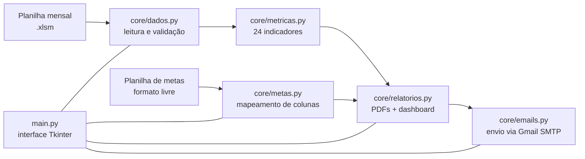

<h1 align="center">Automação de Relatórios Comerciais</h1>

<p align="center">
  App desktop que transforma a planilha mensal da diretoria em <b>relatórios em PDF por região e filial</b>,
  um <b>dashboard consolidado</b> e o <b>envio automático por e-mail</b> para cada gerente —
  um processo que antes era montado à mão, todo mês.
</p>

<p align="center">
  <a href="https://github.com/rafantavares/automacao-relatorios-comerciais/actions/workflows/testes.yml"></a>
  
  
  
  
</p>

---

## Contexto

Projeto real, desenvolvido para uma **fabricante de materiais rodantes** com filiais em várias
regiões do Brasil (empresa familiar; o nome foi omitido e todos os dados deste repositório são
fictícios).

Todo mês a diretoria gera uma planilha com o resultado de cada filial. A partir dela, alguém
precisava montar um relatório por filial e um por região, calcular ~24 indicadores
(margem, lucro, inadimplência, prazo médio de recebimento…), colorir o que estava bom ou ruim
e mandar cada arquivo para o gerente certo. Trabalho manual, repetitivo e fácil de errar.

## O que o app faz

1. **Lê** a planilha mensal da diretoria (`.xlsm`), validando as colunas e avisando exatamente qual falta.
2. **Calcula** 24 indicadores por filial, com subtotal por região e total geral — fórmulas
   **conferidas célula a célula** contra um relatório real e travadas por testes.
3. **Compara com metas** opcionais, com um **mapeamento flexível de colunas**: se a planilha de metas
   mudar de formato no mês seguinte, o usuário remapeia pela tela, sem mexer no código.
4. **Gera PDFs** (um por filial, um por região) com cores por desempenho, além de um **dashboard
   geral** com gráficos de faturamento, lucro e inadimplência.
5. **Envia por e-mail** cada relatório só para o gerente responsável, com **modo teste** (tudo vai
   primeiro para você), envio seletivo e cancelamento no meio da fila.

## Decisões de engenharia

| Decisão | Por quê |
|---|---|
| **Tudo roda localmente**, sem nuvem nem IA | São dados financeiros da empresa. A única coisa que sai do computador é o e-mail que o usuário decide enviar. |
| **App desktop (Tkinter) + `.bat` de instalação** | O usuário final não é técnico. Instalar = dois cliques; há opção de gerar um `.exe` com PyInstaller. |
| **Fórmulas travadas por testes** | Qualquer mudança que altere um número precisa quebrar um teste conscientemente, não passar despercebida. |
| **Mapeamento de metas configurável** | A planilha de metas muda de formato com frequência; o código não deveria precisar mudar junto. |
| **Senha de app do Gmail**, nunca a senha da conta | Revogável a qualquer momento sem afetar a conta principal. |
| **Envio em thread com cancelamento** | A interface não trava durante o envio, e o usuário pode interromper a fila. |

## Arquitetura



## Testes

66 testes automatizados (`pytest`), rodando no CI em um runner Windows:

- **Métricas, leitura de dados e metas:** unidade, com valores de referência.
- **Relatórios:** geram os PDFs de verdade e conferem o conteúdo com `pypdf`.
- **E-mails:** envio simulado, roteamento filial/região, modo teste, cancelamento.
- **Interface:** testes de fumaça que abrem a janela Tk real, preenchem os campos e acionam os
  mesmos métodos dos botões.

```bash
pip install -r requirements-dev.txt
python -m pytest tests/
```

## Rodando

```bash
pip install -r requirements.txt
python main.py
```

Use `exemplo_dados/dados_exemplo.xlsx` (mês **Agosto**, ano **2026**) para ver o fluxo completo
com dados fictícios. O passo a passo para o usuário final — instalação pelos `.bat`, geração do
`.exe`, configuração do Gmail e solução de problemas — está no
[**manual do usuário**](docs/manual-do-usuario.md).

## Stack

Python 3.12 · Tkinter · openpyxl · ReportLab · matplotlib · smtplib · PyInstaller · pytest · pypdf

## Uso de IA no desenvolvimento

Desenvolvido com o apoio do [Claude Code](https://claude.com/claude-code). Levantamento do
processo com o cliente, regras de negócio, validação das fórmulas contra o relatório real e
testes de aceitação feitos por mim.

## Autor

**Rafael Nunes Tavares** — [github.com/rafantavares](https://github.com/rafantavares)
